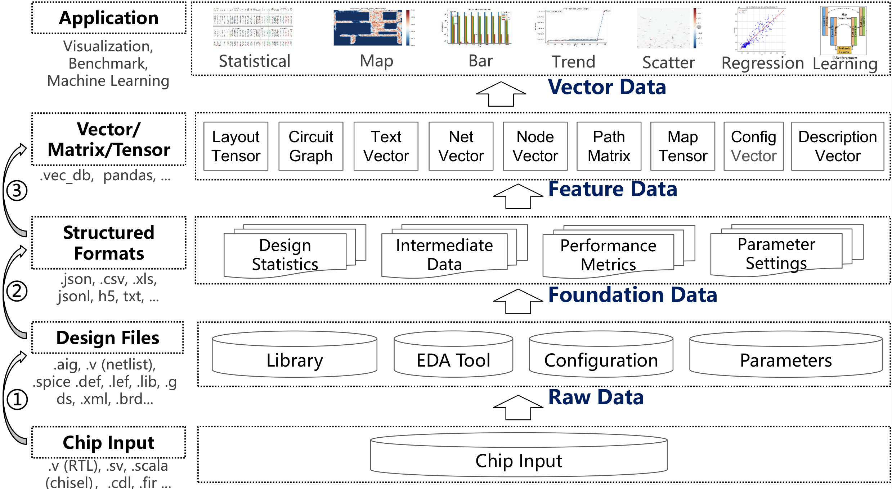
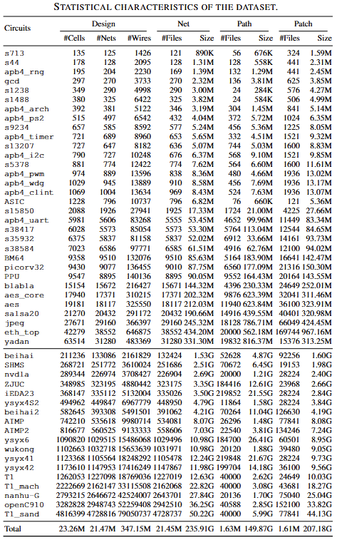

<div align="center">


<h3>An Open-Source AI-Native EDA Library for Design Flows and Design-to-Vector Workflows</h3>

<p align="center">
    <a title="GitHub Watchers" target="_blank" href="https://github.com/OSCC-Project/AiEDA/watchers">
        
    </a>
    <a title="GitHub Stars" target="_blank" href="https://github.com/OSCC-Project/AiEDA/stargazers">
        
    </a>
    <a title="GitHub Forks" target="_blank" href="https://github.com/OSCC-Project/AiEDA/network/members">
        
    </a>
</p>

</div>

## Overview

AiEDA is an AI-native EDA library for running design flows, extracting vectorized design data, and building AI-EDA tasks on top of standardized Python APIs. It combines workspace management, flow orchestration, tool wrappers, data extraction, analysis, and AI task baselines in one Python package.

Today, AiEDA is primarily centered on iEDA-backed flows and vector extraction; the next iteration will generalize these interfaces for multi-tool AI-EDA workflows.

<div align="center">

<h3>Data Transformation for AI-Aided Design</h3>
</div>

## What AiEDA Provides

- Workspace-based project setup and path management for repeatable experiments.
- iEDA-backed physical design flow execution and design vector extraction.
- Analysis and reporting utilities for design, net, path, and patch data.
- AI task baselines for prediction and optimization, including wirelength, delay, congestion, and DSE workflows.
- Python APIs that connect design data, EDA flows, and AI pipelines in one place.

## How AiEDA Is Organized

AiEDA is organized around four layers that match how users work with the library:

- `aieda.workspace`: creates and manages a design workspace, configs, and output paths.
- `aieda.flows`: runs tool flows and data-generation workflows such as `RunIEDA` and `DataGeneration`.
- `aieda.eda`: wraps EDA tool capabilities. Today this layer is implemented around `iEDA`.
- `aieda.data`, `aieda.analysis`, `aieda.ai`, and `aieda.report`: consume generated data for vectorization, analysis, reporting, and AI tasks.

If you want API details, start with [docs/api/workspace.md](./docs/api/workspace.md), [docs/api/ieda_python_api_summary.md](./docs/api/ieda_python_api_summary.md), and the examples under [example/](./example/).

## Quick Start

### Recommended Setup

```bash
git clone <repository-url>
cd AiEDA
git submodule update --init --recursive

# Recommended: use the provided script
./build.sh --skip-build

# Or install manually with uv
pip install uv
uv venv
source .venv/bin/activate
uv pip install -e .
```

To build the iEDA Python extension:

```bash
mkdir build
cd build
cmake ..
make -j32 ieda_py
```

Notes:
- Build `ieda_py` from the AiEDA repository root, not from `aieda/third_party/iEDA/`.
- Some environments may require elevated privileges to fetch extra system dependencies during the native build.

### Minimal Example

```python
from aieda.workspace import workspace_create
from aieda.flows import RunIEDA, DataGeneration

workspace = workspace_create(directory="./my_design", design="gcd")

run_ieda = RunIEDA(workspace)
run_ieda.run_flow()

data_gen = DataGeneration(workspace)
data_gen.generate_vectors()
```

### Common Checks

```bash
# End-to-end example flow
uv run python test/test_sky130_gcd.py

# iEDA-backed physical design flow
uv run python test/test_ieda_flows.py

# Vector extraction
uv run python test/test_ieda_vectors.py
```

## Next Iteration

AiEDA is moving from an `iEDA-first` research library toward a more general AI-EDA runtime. The next iteration focuses on four directions:

1. **Decouple vectorization from iEDA-specific implementation**  
   Today, vector extraction is tightly coupled to `RunIEDA`, `IEDAVectorization`, and `output/iEDA` / `config/iEDA_config` conventions. The next step is to move vectorization toward lighter-weight, tool-agnostic data extraction and vector APIs.

2. **Support multiple tool backends, including OpenROAD**  
   Public flow objects already carry an `eda_tool` field, but the main implementation is still centered on iEDA. We plan to extend the current workspace and flow abstractions so multiple tool backends can plug into the same workflow, with OpenROAD as a priority direction.

3. **Build an agent-native automation layer**  
   AiEDA already contains workspace management, flow orchestration, reporting, and AI task components. The next step is to expose these capabilities through interfaces that are easier for agents to call for automated execution, result collection, and optimization loops.

4. **Expand AI-EDA tasks and general-purpose APIs**  
   The repository already includes tasks such as wirelength prediction, delay prediction, congestion prediction, and DSE. We plan to expand task coverage and stabilize the APIs used to access data, run flows, and consume results across tasks.

## iDATA Dataset

AiEDA also serves as the generation pipeline for **iDATA**, a structured dataset for AI-aided design research.

- The repository already includes open examples and sample outputs under [example/](./example/).
- Sample vectorized data for `gcd` is available in the public repository for inspection and experimentation.
- The full iDATA release is still being prepared because it requires packaging, size reduction, and anonymization work.

<div align="center">

<h3>Statistical Characteristics of the iDATA Dataset</h3>
</div>

## Research and Publications

### Main paper for this repository

- **AiEDA: An Open-Source AI-Aided Design Library for Design-to-Vector**, IEEE Transactions on Computer-Aided Design of Integrated Circuits and Systems (TCAD), 2025

```bibtex
@article{qiu2025aieda,
  title={AiEDA: An Open-Source AI-Aided Design Library for Design-to-Vector},
  author={Qiu, Yihang and Huang, Zengrong and Tao, Simin and Zhang, Hongda and Li, Weiguo and Lai, Xinhua and Wang, Rui and Wang, Weiqiang and Li, Xingquan},
  journal={IEEE Transactions on Computer-Aided Design of Integrated Circuits and Systems (TCAD)},
  year={2025},
  organization={IEEE}
}
```

### Related publications

- AiEDA2.0: An Open-source AI-Aided Design (AAD) Library for Design-to-Vector, ISEDA, 2025
- iEDA: An Open-source infrastructure of EDA, ASPDAC, 2024
- iPD: An Open-source intelligent Physical Design Tool Chain, ASPDAC, 2024

## Contributing

We welcome contributions. Please open an issue or submit a pull request if you want to improve workflows, data extraction, AI tasks, or documentation.

## License

This project is open source. See [LICENSE](./LICENSE) for details.

## Support

- Documentation: [https://ieda.oscc.cc/en/aieda/library/](https://ieda.oscc.cc/en/aieda/library/)
- DeepWiki: [https://deepwiki.com/OSCC-Project/AiEDA](https://deepwiki.com/OSCC-Project/AiEDA)
- Contact: [https://ieda.oscc.cc/en/publicity/connection.html](https://ieda.oscc.cc/en/publicity/connection.html)

## Star History

[](https://star-history.com/#OSCC-Project/AiEDA)
